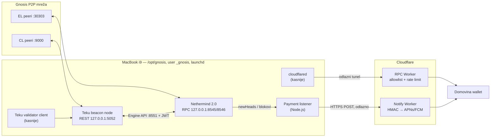

# Domovina Gnosis Node

Vlastiti Gnosis Chain čvor (execution + consensus) na namjenskom **MacBook Pro 16" Intel i9 / 64 GB / 1 TB**, nativno pod macOS-om, bez Dockera. Kasnije i **jedan validator (1 GNO)**.

Čemu služi:

- **Vlastiti RPC** (HTTP + WebSocket) za Domovina self-custody novčanik: bez Infure i Alchemyja, bez rate limita i bez trećih strana koje vide korisničke adrese.
- **Push notifikacije o uplatama**: lokalni listener prati blokove i šalje potpisane evente na Cloudflare Worker, a Worker šalje APNs/FCM.
- **Validator** kao doprinos Gnosis mreži iz Hrvatske.

Ovaj repo je **single source of truth**: odluke, verzije, skripte i runbookovi su ovdje. Sve što ne piše ovdje ne postoji.

## Stanje

| Dio | Status |
| --- | --- |
| Skripte za instalaciju (Nethermind 2.0.0 + Teku 26.9.1) | spremno, testirano na arm64 u test modu; čeka prvo pokretanje na i9 |
| launchd servisi, `gnosisctl` | spremno |
| Payment listener | spremno, testirano protiv javnog Gnosis RPC-a |
| RPC prema van (Cloudflare Tunnel + Worker) | dizajn u [docs/06](docs/06-rpc-exposure.md); Worker nije napisan |
| Validator | procedura u [docs/08](docs/08-validator.md); ključevi nisu generirani |

## Brzi početak (na i9 MacBooku)

Cijeli postupak s objašnjenjima je u **[docs/04-install-runbook.md](docs/04-install-runbook.md)**. Ukratko:

```bash
git clone https://github.com/domovinatv/domovina-gnosis-node.git ~/domovina-gnosis-node
cd ~/domovina-gnosis-node
cp config/node.env.example config/node.env     # pregledaj vrijednosti

scripts/00-preflight.sh                        # samo čita; mora proći
sudo scripts/10-host-setup.sh                  # service user, /opt/gnosis, JWT, pmset, update, firewall
sudo scripts/20-install.sh                     # Nethermind, Java, Teku (SHA-256 provjera)
sudo scripts/30-services.sh install            # launchd daemoni, start
scripts/gnosisctl health                       # ponavljaj dok se ne sinkronizira
```

## Arhitektura u jednoj slici



Na routeru nema port forwardinga: sav promet prema Cloudflareu je odlazan.

## Karta repozitorija

```
config/versions.env        verzije + SHA-256 svega što se instalira (jedino mjesto)
config/node.env.example    sve postavke čvora (kopija → config/node.env, gitignored)
scripts/00-preflight.sh    provjere stroja, samo čita
scripts/10-host-setup.sh   jednokratna priprema macOS-a (sudo)
scripts/20-install.sh      download + verifikacija + instalacija komponenti (sudo)
scripts/25-build-lighthouse.sh  opcionalno: Lighthouse iz izvornog koda
scripts/30-services.sh     generira launchd plistove iz configa, (un)load (sudo)
scripts/40-validator.sh    uvoz ključeva, slashing-protection, exit (sudo)
scripts/gnosisctl          status / health / logs / start / stop / restart
listener/                  payment listener (Node 22+, bez npm ovisnosti)
docs/                      baza znanja, vidi dolje
docs/research/             sirovi istraživački nalazi s izvorima (2026-10-01)
```

## Dokumentacija

1. [Arhitektura](docs/01-architecture.md): komponente, tok podataka, raspored na disku, portovi
2. [Odluke (ADR)](docs/02-decisions.md): zašto Teku, zašto LaunchDaemon, zašto `/opt`…
3. [MacBook kao server](docs/03-macbook-host.md): napajanje, baterija, FileVault, updateovi, toplina
4. [Instalacija korak po korak](docs/04-install-runbook.md)
5. [Operacije](docs/05-operations.md): gnosisctl, upgrade i hard forkovi, restart, backup, troubleshooting
6. [RPC prema van](docs/06-rpc-exposure.md): Cloudflare Tunnel + Worker
7. [Notifikacije o uplatama](docs/07-wallet-notifications.md): listener i ugovor s Workerom
8. [Validator](docs/08-validator.md): ključevi, depozit, rad, izlaz
9. [Sigurnost i model prijetnji](docs/09-security.md)

Dnevnik rada: [2026-10-01 — prepisivanje, zamke, otvorene stavke za i9](docs/2026-10-01-prepisivanje-i-otvorene-stavke.md), [2026-10-10 — prvi preflight na i9, čišćenje diska](docs/2026-10-10-prvo-pokretanje-i9-disk.md)

## Pravila

- Nikad ne pokreći iste validatorske ključeve na dva mjesta istovremeno (slashing).
- Prije svakog Gnosis hard forka nadogradi klijente ([docs/05](docs/05-operations.md#hard-forkovi)).
- Tajne ne idu u git: JWT, lozinke keystorea, `WEBHOOK_SECRET` i mnemonic žive samo na čvoru ili na papiru.
