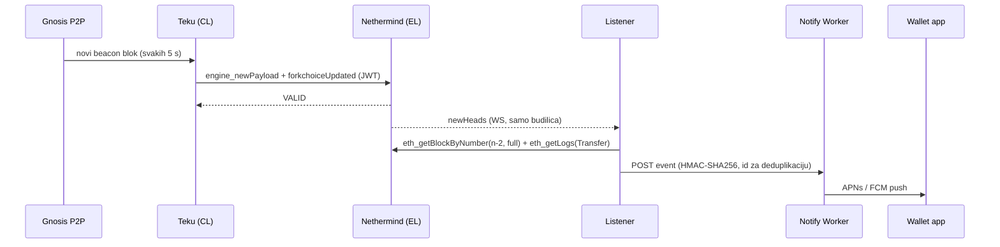

# 01 — Arhitektura

## Komponente

| Komponenta | Što radi | Proces | Port(ovi) |
| --- | --- | --- | --- |
| **Nethermind 2.0** (EL) | izvršava blokove, drži stanje, služi JSON-RPC | `/opt/gnosis/nethermind/current/nethermind` | 8545 HTTP, 8546 WS, 8551 Engine (svi 127.0.0.1); 30303 TCP/UDP P2P |
| **Teku 26.x** (CL beacon node) | konsenzus, prati beacon chain, vodi EL kroz Engine API | `java … tech.pegasys.teku.Teku` | 5052 REST, 8008 metrics (127.0.0.1); 9000 TCP/UDP P2P, 9001 UDP QUIC |
| **Teku validator client** (kasnije) | potpisuje atestacije i blokove za 1 validator | `java … Teku validator-client` | 8009 metrics (127.0.0.1) |
| **Payment listener** | prati uplate na adrese korisnika, šalje evente Workeru | `node listener.mjs` | — (samo odlazno) |
| **cloudflared** (kasnije) | odlazni tunel do Cloudflarea za RPC | `cloudflared` | — (samo odlazno) |

EL i CL dijele 32-bajtni JWT (`/opt/gnosis/secrets/jwt.hex`) kojim se autentificira Engine API.

## Tok podataka



Gnosis parametri ([configs/mainnet](https://github.com/gnosischain/configs/blob/main/mainnet/config.yaml)):

- slot je 5 s, a epoha 16 slotova (80 s);
- finalizacija traje oko 2 epohe, otprilike 160 s;
- zadnji fork je Fulu/Fusaka, 2026-04-14. Sljedeći trenutno nije zakazan (stanje 2026-10-01).

## Raspored na disku

Sve živi u `/opt/gnosis`, izvan korisničkog `home`-a. Daemoni tako ne ovise o ulogiranom korisniku ni o macOS privacy dozvolama.

```
/opt/gnosis/                      root:wheel 755
├── nethermind/<ver>/  current →  binariji, root vlasnik (servis ih ne može mijenjati)
├── teku/<ver>/        current →
├── jre/<ver>/         current →  Temurin 25 (za Teku)
├── node/<ver>/        current →  Node.js LTS (za listener)
├── lighthouse/<ver>/  current →  samo ako se gradi (CL_CLIENT=lighthouse)
├── cloudflared/<ver>/ current →  samo ako se izlaže RPC
├── listener/listener.mjs         kopija iz repoa (deploy = 20-install.sh listener)
├── cache/                        preuzete arhive (provjerene SHA-256)
├── etc/                          root:_gnosis 750 — listener.env, watchlist.json
├── secrets/jwt.hex               _gnosis 700/600
├── validator/{keys,passwords}    _gnosis 700 — samo kad postoji validator
├── data/{nethermind,teku,validator}   _gnosis 750 — baze
├── logs/                         _gnosis 750 — NLog/log4j rotiraju sami; *.stderr.log od launchd
└── state/                        _gnosis — listener-state.json, listener.pid
```

Verzije su u zasebnim direktorijima, a `current` je symlink. Upgrade instalira novu verziju pored stare, a rollback je samo `ln -sfn <stara> current` i restart.

## Procesi i launchd

Svi servisi su **LaunchDaemoni** (`/Library/LaunchDaemons/tv.domovina.gnosis.<servis>.plist`) i rade kao skriveni korisnik `_gnosis`. Plistove generira `scripts/30-services.sh` iz `config/node.env`, pa se ne commitaju. Detalji su u [ADR-004](02-decisions.md#adr-004) i [docs/05](05-operations.md).

| Label | KeepAlive | ExitTimeOut |
| --- | --- | --- |
| `tv.domovina.gnosis.nethermind` | uvijek | 180 s (RocksDB flush) |
| `tv.domovina.gnosis.teku` | uvijek | 120 s |
| `tv.domovina.gnosis.validator` | uvijek | 60 s |
| `tv.domovina.gnosis.listener` | samo nakon greške (izlaz 0 = konfiguracijska greška, ne ponavljaj) | 15 s |

launchd ne zna za ovisnosti između servisa. Svaki klijent sam ponavlja spajanje dok drugi ne proradi, pa redoslijed pokretanja nije bitan. Redoslijed gašenja jest bitan, i za to služi `gnosisctl stop all`.

## Mreža

- Svi RPC/REST/metrics portovi vežu se na `127.0.0.1`.
- Na routeru se forwardaju **samo P2P portovi** (30303 TCP/UDP, 9000 TCP/UDP, 9001 UDP), [ADR-009](02-decisions.md#adr-009). Bez forwarda P2P radi samo odlaznim vezama: čvor radi, ali s manje peerova (na i9 4–5 EL peerova).
- UPnP je isključen: Nethermind ga ima isključenog po defaultu, a Teku dobiva `--p2p-nat-method=NONE`.
- Promet prema van:
  - P2P;
  - HTTPS POST listenera prema Workeru;
  - cloudflared tunel (kasnije);
  - checkpoint sync pri prvom pokretanju.
