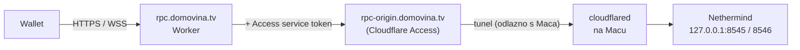

# 06 — RPC prema van (Cloudflare Tunnel + Worker)

> Status: **dizajn**. Worker nije napisan. Čvor mora biti sinkroniziran prije ovog koraka.

## Problem

Novčaniku treba JSON-RPC (stanja, povijest, slanje transakcija), a na routeru ne smije biti otvoren port ([ADR-005](02-decisions.md#adr-005)).

## Rješenje



1. **cloudflared** na Macu otvara odlaznu vezu prema Cloudflareu. Tunel podržava WebSocket ([Cloudflare FAQ](https://developers.cloudflare.com/cloudflare-one/faq/cloudflare-tunnels-faq/)).
2. **Origin hostname** (`rpc-origin…`) je iza Cloudflare Access aplikacije s Service Auth politikom i propušta samo zahtjeve sa service tokenom.
3. **Worker** na javnom hostnameu:
   - propušta samo dopuštene metode, na primjer:
     - `eth_chainId`, `eth_blockNumber`, `eth_getBalance`, `eth_call`, `eth_estimateGas`
     - `eth_gasPrice`, `eth_maxPriorityFeePerGas`, `eth_feeHistory`, `eth_getTransactionCount`
     - `eth_getTransactionByHash`, `eth_getTransactionReceipt`, `eth_getBlockByNumber`
     - `eth_getLogs` uz ograničen raspon blokova, `eth_sendRawTransaction`, `net_version`
     - `eth_subscribe` samo za `newHeads` i `logs`
   - odbija `admin_*`, `debug_*`, `trace_*`, `txpool_*`, `personal_*`, `engine_*` i batch zahtjeve veće od N;
   - ograničava broj zahtjeva po IP-u ili po app ključu (Workers Rate Limiting binding);
   - dodaje `CF-Access-Client-Id` i `CF-Access-Client-Secret` iz Worker secreta;
   - kod WebSocketa proxira frame po frame, kako bi mogao filtrirati metode.

**Nikad** se ne izlaže sirovi origin, ni Engine API (8551). Service token se ne ugrađuje u mobilnu aplikaciju, jer se iz nje može izvući.

Nethermind već ima ograničene module (`[Eth,Net,Web3,Subscribe,Health]`), pa ni zaobilaženje Workera ne otvara admin ili debug metode.

## Postavljanje na Macu

Hostnameovi ispod (`*.domovina.tv`) su primjer; stvarna zona se bira pri `tunnel login`.

```bash
sudo scripts/20-install.sh cloudflared
sudo mkdir -p /usr/local/bin
sudo ln -sf /opt/gnosis/cloudflared/current/cloudflared /usr/local/bin/cloudflared

cloudflared tunnel login                     # otvara browser, bira zonu domovina.tv
cloudflared tunnel create gnosis-node        # stvara UUID i credentials JSON u ~/.cloudflared/
sudo mkdir -p /etc/cloudflared
sudo cp ~/.cloudflared/<UUID>.json /etc/cloudflared/
```

`/etc/cloudflared/config.yml`:

```yaml
tunnel: <UUID>
credentials-file: /etc/cloudflared/<UUID>.json
ingress:
  - hostname: rpc-origin.domovina.tv
    service: http://127.0.0.1:8545
  - hostname: ws-origin.domovina.tv
    service: http://127.0.0.1:8546      # WS upgrade prolazi kroz http:// servis
  - service: http_status:404
```

```bash
cloudflared tunnel route dns gnosis-node rpc-origin.domovina.tv
cloudflared tunnel route dns gnosis-node ws-origin.domovina.tv
sudo cloudflared service install             # LaunchDaemon com.cloudflare.cloudflared
```

`cloudflared service install` sa sudo stvara **LaunchDaemon**, a bez sudo LaunchAgent, koji ovdje ne želimo. Logovi su u `/Library/Logs/com.cloudflare.cloudflared.*.log`. Provjeriti i BTM: `sudo sfltool dumpbtm | grep -A8 cloudflare`.

## Cloudflare strana

1. Zero Trust → Access → Applications: dodati self-hosted aplikaciju za `rpc-origin` i `ws-origin`. Politika je Service Auth, a uz nju se stvara service token.
2. Worker `domovina-gnosis-rpc`:
   - javni route `rpc.domovina.tv`;
   - secreti `ACCESS_CLIENT_ID` i `ACCESS_CLIENT_SECRET`;
   - rate limit binding.
3. Worker ima vlastiti repo ili direktorij. Njegov kod ne pripada ovom repou, ali ovaj dokument je njegov ugovor.

## Što Cloudflare vidi

Cloudflare vidi sav RPC promet: IP adrese aplikacija i adrese koje se upituju. To je svjesni kompromis ([docs/09](09-security.md)).
