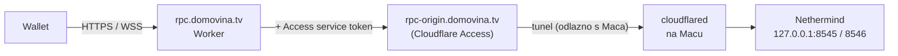

# 06 — RPC prema van (Cloudflare Tunnel + Worker)

> Status: **faza 1 u postavljanju** (tunel za vlastite Workere, [ADR-011](02-decisions.md#adr-011)). Javni proxy Worker (faza 2) nije napisan. Dovršetak za čvor `acutis`: [predaja 2026-10-22](2026-10-22-predaja-acutis-tunel.md). Čvor mora biti sinkroniziran prije ovog koraka. Plan i redoslijed (faza 1: tunel za vlastite Workere s Access service tokenom; faza 2: javni proxy ispod) su u [2026-10-11 — plan port forwarda i tunela](2026-10-11-plan-port-forward-i-tunel.md).

## Problem

Novčaniku treba JSON-RPC (stanja, povijest, slanje transakcija), a na routeru ne smije biti otvoren port ([ADR-005](02-decisions.md#adr-005)).

## Rješenje



1. **cloudflared** na Macu otvara odlaznu vezu prema Cloudflareu. Tunel podržava WebSocket ([Cloudflare FAQ](https://developers.cloudflare.com/cloudflare-one/faq/cloudflare-tunnels-faq/)).
2. **Origin hostname** (`rpc-origin…`) je iza Cloudflare Access aplikacije s Service Auth politikom i propušta samo zahtjeve sa service tokenom.
3. **Worker** na javnom hostnameu:
   - propušta samo dopuštene metode, na primjer:
     - `eth_chainId`, `eth_blockNumber`, `eth_getBalance`, `eth_call`, `eth_estimateGas`
     - `eth_gasPrice`, `eth_maxPriorityFeePerGas`, `eth_feeHistory`, `eth_getTransactionCount`
     - `eth_getTransactionByHash`, `eth_getTransactionReceipt`, `eth_getBlockByNumber`
     - `eth_getLogs` uz ograničen raspon blokova, `eth_sendRawTransaction`, `net_version`
     - `eth_subscribe` samo za `newHeads` i `logs`
   - odbija `admin_*`, `debug_*`, `trace_*`, `txpool_*`, `personal_*`, `engine_*` i batch zahtjeve veće od N;
   - ograničava broj zahtjeva po IP-u ili po app ključu (Workers Rate Limiting binding);
   - dodaje `CF-Access-Client-Id` i `CF-Access-Client-Secret` iz Worker secreta;
   - kod WebSocketa proxira frame po frame, kako bi mogao filtrirati metode.

**Nikad** se ne izlaže sirovi origin, ni Engine API (8551). Service token se ne ugrađuje u mobilnu aplikaciju, jer se iz nje može izvući.

Nethermind već ima ograničene module (`[Eth,Net,Web3,Subscribe,Health]`), pa ni zaobilaženje Workera ne otvara admin ili debug metode.

## Postavljanje na Macu

Faza 1 ([ADR-011](02-decisions.md#adr-011)): tunel po čvoru, hostnameovi `<NODE_NAME>-rpc.mpt.hr` i `<NODE_NAME>-ws.mpt.hr`. Primjer je čvor `acutis` (i9). Naredbe bez `sudo` pokreće korisnik `ms`; sudo naredbe idu u iTerm, jedna po jedna.

```bash
sudo scripts/20-install.sh cloudflared                 # verzija iz config/versions.env
CFD=/opt/gnosis/cloudflared/current/cloudflared        # ne Homebrewov /usr/local/bin/cloudflared

$CFD tunnel login                                      # browser, zona mpt.hr; piše ~/.cloudflared/cert.pem
$CFD tunnel create acutis                              # ispisuje UUID, credentials u ~/.cloudflared/<UUID>.json
$CFD tunnel route dns acutis acutis-rpc.mpt.hr
$CFD tunnel route dns acutis acutis-ws.mpt.hr

sudo mkdir -p /opt/gnosis/secrets/cloudflared
sudo mv ~/.cloudflared/<UUID>.json /opt/gnosis/secrets/cloudflared/
sudo chown -R _gnosis:_gnosis /opt/gnosis/secrets/cloudflared
sudo chmod 700 /opt/gnosis/secrets/cloudflared; sudo chmod 600 /opt/gnosis/secrets/cloudflared/<UUID>.json
```

U lokalnom `config/node.env`:

```bash
TUNNEL_ENABLED=true
NODE_NAME=acutis
TUNNEL_ZONE=mpt.hr
TUNNEL_ID=<UUID>
```

```bash
sudo scripts/30-services.sh install tunnel             # generira /opt/gnosis/etc/cloudflared/config.yml i plist
scripts/gnosisctl logs tunnel                          # traži "Registered tunnel connection" (4 veze)
rm ~/.cloudflared/cert.pem                             # vrijedi za cijelu zonu; treba samo za create i route dns
```

Generirani `config.yml` vodi `<NODE_NAME>-rpc` na `127.0.0.1:$EL_HTTP_PORT`, `<NODE_NAME>-ws` na `127.0.0.1:$EL_WS_PORT`, a sve ostalo na 404. Provjera: `$CFD tunnel --config /opt/gnosis/etc/cloudflared/config.yml ingress validate`.

Ne koristi se `cloudflared service install`: pokreće `cloudflared` kao root, s autoupdateom i plistom izvan repoa. Kad se `cert.pem` opet zatreba (novi hostname), ponovi se `tunnel login`.

## Cloudflare strana

**Faza 1 (vlastiti Workeri):**

1. Zero Trust → Access → Service Auth → Service Tokens: po jedan token za svaki Worker koji zove RPC (npr. `eure-reader`). Client Secret se vidi samo jednom.
2. Zero Trust → Access → Applications → Self-hosted: aplikacija `acutis-rpc` s hostnameovima `acutis-rpc.mpt.hr` i `acutis-ws.mpt.hr`. Politika s akcijom **Service Auth** koja uključuje te service tokene. Bez ijedne Allow politike za ljude.
3. U Workeru: `wrangler secret put CF_ACCESS_CLIENT_ID` i `CF_ACCESS_CLIENT_SECRET`, i slati ih kao zaglavlja `CF-Access-Client-Id` / `CF-Access-Client-Secret`.
4. Test:
   ```bash
   curl -s -o /dev/null -w '%{http_code}\n' https://acutis-rpc.mpt.hr      # 403 (ili redirect na login) bez tokena
   curl -s https://acutis-rpc.mpt.hr -H "CF-Access-Client-Id: $ID" -H "CF-Access-Client-Secret: $SECRET" \
     -H 'content-type: application/json' --data '{"jsonrpc":"2.0","id":1,"method":"eth_blockNumber","params":[]}'
   ```

**Faza 2 (javni proxy za novčanik):**

1. Ista Access aplikacija, poseban service token za proxy Worker.
2. Worker `domovina-gnosis-rpc`:
   - javni route `rpc.domovina.tv`;
   - secreti `ACCESS_CLIENT_ID` i `ACCESS_CLIENT_SECRET`;
   - rate limit binding.
3. Worker ima vlastiti repo ili direktorij. Njegov kod ne pripada ovom repou, ali ovaj dokument je njegov ugovor.

## Što Cloudflare vidi

Cloudflare vidi sav RPC promet: IP adrese aplikacija i adrese koje se upituju. To je svjesni kompromis ([docs/09](09-security.md)).
