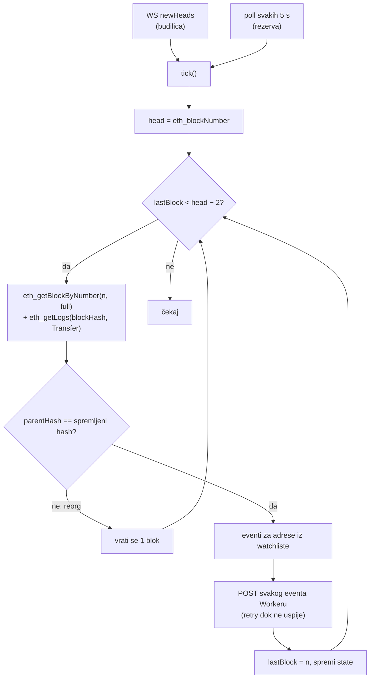

# 07 — Notifikacije o uplatama (listener)

`listener/listener.mjs` prati čvor i za svaku uplatu na praćenu adresu šalje potpisan event Cloudflare Workeru. Worker zatim šalje APNs ili FCM push. Dizajn je opisan u [ADR-008](02-decisions.md#adr-008).

## Kako radi



Što listener radi:

- **Native xDAI:** `tx.to` je na watchlisti i `value > 0`.
- **ERC-20:** log `Transfer(address,address,uint256)` s 3 topica, kojemu je `to` na watchlisti. ERC-721 ima 4 topica i preskače se. Simbol i decimale tokena čita preko `eth_call` i sprema ih u cache.
- **Isporuka:** at-least-once. Blok se ne označava obrađenim dok Worker ne vrati 2xx.
  - Na 5xx/429 ili mrežnu grešku listener pokušava ponovno, s backoffom do 60 s.
  - Na 4xx (Worker odbija event) event se preskače.
- **Restart:** listener nastavlja iz `state/listener-state.json` i nadoknađuje do `MAX_BACKFILL` blokova (720, otprilike 1 h).
- **Watchlist** (`/opt/gnosis/etc/watchlist.json`, JSON niz adresa) se ponovno učitava čim se fajl promijeni, bez restarta.

## Ograničenja {#ograničenja}

- **Internal xDAI transferi** se ne vide: to je xDAI koji šalje ugovor, na primjer Safe, bridge ili DEX. Za njih bi trebalo `trace_block`, odnosno Nethermindov `Trace` modul, što je kasnija nadogradnja. Za Safe novčanike to je bitno.
- **Kašnjenje** je 2 bloka potvrde plus trajanje bloka, otprilike 10–15 s.
- **Velika watchlista:** `eth_getLogs` vraća sve Transfer logove bloka, a filtriranje se radi lokalno. Za Gnosis blokove to je jeftino. Kod stotina tisuća adresa vrijedi prijeći na Bloom filter ili Set u memoriji, kao i sada.
- **Spam tokeni** (airdrop scam): listener javlja sve. Odluku o tome što se prikazuje donosi Worker, preko allowliste tokena.

## Ugovor s Workerom

`POST $WEBHOOK_URL`, `content-type: application/json`

Zaglavlja:

```
x-domovina-timestamp: <unix sekunde>
x-domovina-signature: sha256=<hex(HMAC_SHA256(WEBHOOK_SECRET, timestamp + "." + rawBody))>
```

Tijelo zahtjeva:

```json
{
  "id": "0x<txHash>:<logIndex>",
  "type": "ERC20_RECEIVED",
  "blockNumber": 48535890,
  "blockHash": "0x…",
  "timestamp": 1790871315,
  "txHash": "0x…",
  "from": "0x…",
  "to": "0x…",
  "token": "0x…",
  "symbol": "sDAI",
  "decimals": 18,
  "amountRaw": "1500000000000000000",
  "amount": "1.5"
}
```

Polja koja se razlikuju po tipu eventa:

- `type` je `ERC20_RECEIVED` ili `NATIVE_RECEIVED`.
- Za `NATIVE_RECEIVED`:
  - `id` je `<txHash>:native`;
  - `token` je `null`;
  - `symbol` je `"xDAI"`.
- `symbol` i `decimals` mogu biti `null` kod nestandardnih tokena; tada je i `amount` `null`.

Worker mora:

1. odbiti zahtjev ako je `|now − timestamp| > 300` s (zaštita od replaya);
2. izračunati HMAC nad **sirovim** tijelom i usporediti ga u konstantnom vremenu;
3. **deduplicirati po `id`**, jer isti event može stići dvaput (KV ili D1, TTL oko 1 dan);
4. vratiti 2xx tek kad je event spremljen ili u redu za slanje. Na 4xx listener event preskače.

Provjera u Workeru:

```ts
const ts = req.headers.get('x-domovina-timestamp') ?? '';
const sig = req.headers.get('x-domovina-signature') ?? '';
const body = await req.text();
if (Math.abs(Date.now() / 1000 - Number(ts)) > 300) return new Response('stale', { status: 401 });
const key = await crypto.subtle.importKey('raw', new TextEncoder().encode(env.WEBHOOK_SECRET),
  { name: 'HMAC', hash: 'SHA-256' }, false, ['verify']);
const mac = Uint8Array.from(sig.replace('sha256=', '').match(/../g)!.map((h) => parseInt(h, 16)));
const ok = await crypto.subtle.verify('HMAC', key, mac, new TextEncoder().encode(`${ts}.${body}`));
if (!ok) return new Response('bad signature', { status: 401 });
```

`crypto.subtle.verify` uspoređuje u konstantnom vremenu.

## Uključivanje

```bash
# config/node.env: LISTENER_ENABLED=true
sudo scripts/20-install.sh node listener
sudo vi /opt/gnosis/etc/listener.env          # WEBHOOK_URL, WEBHOOK_SECRET (openssl rand -hex 32)
sudo vi /opt/gnosis/etc/watchlist.json        # ["0x…", "0x…"]
sudo scripts/30-services.sh install listener
scripts/gnosisctl logs listener
```

Deploy nove verzije listenera:

```bash
git pull
sudo scripts/20-install.sh listener
scripts/gnosisctl restart listener
```

Ako je `WEBHOOK_URL` postavljen, a secret kraći od 32 znaka, listener zapiše grešku i izađe s kodom 0. launchd ga tada ne vrti u krug.

## Lokalni test (bilo koji Mac, bez čvora)

```bash
echo '["0xe92f45287ba17765b992456af1aa9f7913e5320d"]' > /tmp/watch.json
RPC_HTTP_URL=https://rpc.gnosischain.com RPC_WS_URL= \
  WATCHLIST_FILE=/tmp/watch.json STATE_FILE=/tmp/state.json \
  node listener/listener.mjs
```

Bez `WEBHOOK_URL` eventi se samo ispisuju. Adresa u primjeru je jedna od najaktivnijih primateljica na Gnosisu na dan testiranja (2026-10-01).

## Odakle watchlista

Zasad je to ručni JSON fajl. Kasnije bi se trebao sinkronizirati iz Workera, odnosno iz D1 baze s adresama koje su korisnici registrirali. Listener bi tada periodično povlačio listu preko HTTPS GET-a s istim HMAC-om. Izvor adresa je ionako Worker.
