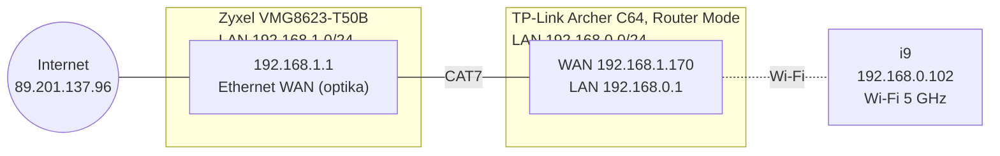
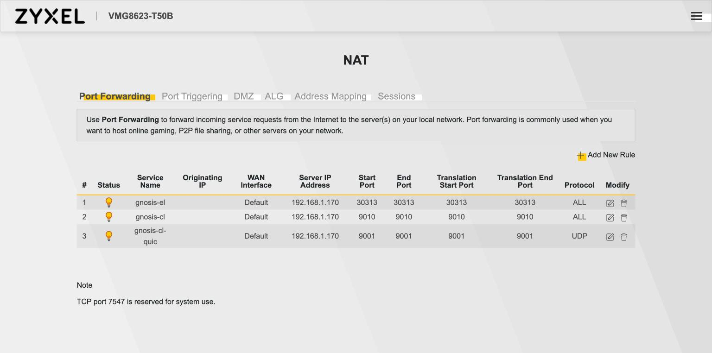
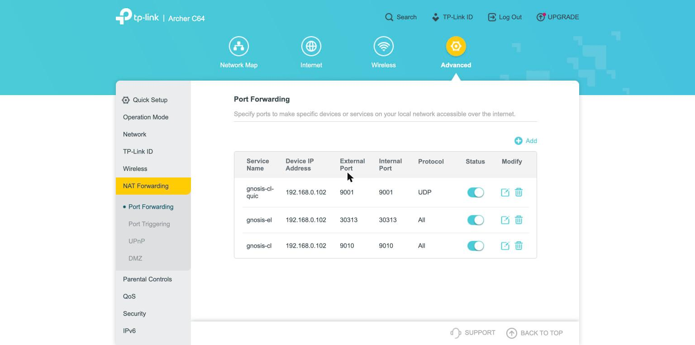

# 10 — Mreža i port forwarding

> Stanje na dan 2026-10-22. Podaci su pročitani iz admin sučelja oba routera i s i9. Nazivi Wi-Fi mreža i MAC adrese nisu ovdje jer je repo javan; čitaju se s routera. Javna IP adresa je ionako javna, jer je čvor objavljuje u enode/ENR zapisu.

## Topologija (ured)

i9 je iza **dvostrukog NAT-a**: optika → Zyxel → TP-Link → i9 (Wi-Fi). Odlazni promet svih uređaja ide preko iste javne IPv4 adrese ureda, **89.201.137.96** (statična).



| Uređaj | Uloga | Adresa | Napomena |
| --- | --- | --- | --- |
| Zyxel VMG8623-T50B | ISP router, NAT prema internetu | 192.168.1.1 | firmware V5.50(ACDV.1)b4, DHCP 192.168.1.2–254, lease 1 dan. Internet ide preko PPPoE sučelja `ETH_INT` (javni IP), a `ETHWAN_VOICE/MGMT` (IPoE, 10.160.x) je operaterov za telefoniju i upravljanje. Ima i vlastiti Wi-Fi, i9 nije na njemu |
| TP-Link Archer C64 | drugi router (NAT), Wi-Fi na kojem je i9 | WAN 192.168.1.170 (DHCP od Zyxela), LAN 192.168.0.1 | firmware 1.11.0 Build 220425, DHCP 192.168.0.100–249, lease 120 min |
| i9 | Gnosis čvor | 192.168.0.102 | Wi-Fi s **privatnom MAC adresom** (macOS „Private Wi-Fi address”), ne MAC-om kartice |

✋ **Wi-Fi na i9 se ne dira.** Na njemu je stabilan od 2026-10-11, a operater se na i9 spaja preko RustDeska. Promjena koja ruši vezu ostavlja ga bez pristupa.

## Port forwarding

Lanac za svaki P2P port: Zyxel (89.201.137.96) → TP-Link WAN 192.168.1.170 → i9 192.168.0.102. Vanjski port je svugdje jednak unutarnjem ([ADR-009](02-decisions.md#adr-009)).

| Port | Protokol | Klijent | Config | Zyxel → | TP-Link → |
| --- | --- | --- | --- | --- | --- |
| 30313 | TCP + UDP | Nethermind (devp2p + discovery) | `EL_P2P_PORT` | 192.168.1.170, „TCP/UDP” (u listi „ALL”) | 192.168.0.102, „All” |
| 9010 | TCP + UDP | Teku (libp2p + discv5) | `CL_P2P_PORT` | 192.168.1.170, „TCP/UDP” (u listi „ALL”) | 192.168.0.102, „All” |
| 9001 | UDP | Teku (QUIC) | `CL_QUIC_PORT` | 192.168.1.170, „UDP” | 192.168.0.102, „UDP” |

Imena pravila na oba routera: `gnosis-el`, `gnosis-cl`, `gnosis-cl-quic`.

Adrese su zaključane DHCP rezervacijama:

- **TP-Link** (Advanced → Network → DHCP Server → Address Reservation): privatna Wi-Fi MAC i9 → 192.168.0.102;
- **Zyxel** (Network Setting → Home Networking → Static DHCP): WAN MAC TP-Linka → 192.168.1.170.

Ako macOS promijeni privatnu MAC adresu (postavka „Rotating” umjesto „Fixed”), i9 dobiva drugu adresu i forward prestaje raditi. Provjera: `ifconfig en0 | grep ether` mora odgovarati rezervaciji na TP-Linku.

## Screenshotovi konfiguracije (2026-10-22)

Snimljeno nakon postavljanja, u admin sučeljima oba routera. MAC adrese i serijski broj su zacrnjeni. Kod promjene na routeru treba snimiti nove slike i zamijeniti ove.

**Zyxel VMG8623-T50B** (192.168.1.1):

| Stranica | Što pokazuje |
| --- | --- |
| [NAT → Port Forwarding](img/routers/zyxel-1-nat-port-forwarding.jpg) | tri pravila prema TP-Linku 192.168.1.170 |
| [Home Networking → Static DHCP](img/routers/zyxel-2-static-dhcp.jpg) | WAN MAC TP-Linka → 192.168.1.170 |
| [Home Networking → LAN Setup](img/routers/zyxel-3-lan.jpg), [DHCP](img/routers/zyxel-4-dhcp-pool.jpg) | LAN 192.168.1.1/24, DHCP .2–.254, lease 1 dan |
| [Home Networking → UPnP](img/routers/zyxel-5-upnp.jpg) | UPnP uključen, mapiranja Tailscalea |
| [NAT → DMZ](img/routers/zyxel-6-dmz.jpg) | DMZ isključen (0.0.0.0) |
| [System Info](img/routers/zyxel-7-system-info.jpg) | firmware, WAN i LAN3/LAN4 na 1000M/Full |
| [System Info → WAN](img/routers/zyxel-8-wan.jpg) | PPPoE `ETH_INT` s javnim IP-om 89.201.137.96 |



**TP-Link Archer C64** (192.168.0.1):

| Stranica | Što pokazuje |
| --- | --- |
| [NAT Forwarding → Port Forwarding](img/routers/tplink-1-port-forwarding.jpg) | tri pravila prema i9 192.168.0.102 |
| [Operation Mode](img/routers/tplink-2-operation-mode.jpg) | Router Mode (zato je NAT dvostruk) |
| [Network → Status, WAN](img/routers/tplink-3-status-wan.jpg) | WAN 192.168.1.170, gateway 192.168.1.1 |
| [Network → Status, LAN](img/routers/tplink-4-status-lan.jpg) | LAN 192.168.0.1, DHCP .100–.249 |
| [Network → DHCP Server](img/routers/tplink-5-dhcp.jpg) | DHCP postavke, lease 120 min |
| [Address Reservation](img/routers/tplink-6-reservation.jpg) | privatna Wi-Fi MAC i9 → 192.168.0.102 |
| [NAT Forwarding → UPnP](img/routers/tplink-7-upnp.jpg) | UPnP uključen, 64 mapiranja |
| [NAT Forwarding → DMZ](img/routers/tplink-8-dmz.jpg) | DMZ isključen |



## Zašto 30313 i 9010, a ne 30303 i 9000

Na TP-Linku pravila za **UDP 30303 i UDP 9000** nisu prošla: „Conflicting with existing port”, iako su tablice Port Forwarding, Port Triggering i DMZ bile prazne. Isti portovi s TCP-om i UDP 9001 su prošli. Najvjerojatnije ih drže UPnP mapiranja koja sučelje ne prikazuje: UPnP je uključen (koristi ga Tailscale), lista javlja 64 mapiranja, a kroz stranice se vidi samo 40. Čvor ne koristi UPnP (`--p2p-nat-method=NONE`, Nethermind ga nema uključenog).

Isključivanje UPnP-a bi očistilo tablicu, ali bi na trenutak prekinulo Tailscale. Zato su odabrani drugi portovi. Isti problem se lako ponovi na drugoj lokaciji, pa su 30313 i 9010 **default u `config/node.env.example`** ([ADR-009, dopuna 2026-10-22](02-decisions.md#adr-009)).

## Objavljena adresa (ENR, enode)

Peerovi se spajaju na adresu i port koje čvor objavi. Nethermind sam otkrije javni IP i objavljuje `tcp/udp 89.201.137.96:30313`.

Teku je nakon prelaska na 9010 u discovery adresi objavio **`udp/23756`**, a ne 9010. Uzrok je discv5, koji objavljenu adresu uči iz odgovora peerova. Routeri su odlazni UDP s porta 9010 prepisali na nasumični vanjski port, i to je Teku upisao u ENR, a na taj port nema forwarda. Prije promjene je slučajno bio objavljen ispravan `udp/9000`, vjerojatno zbog skrivenog UPnP mapiranja koje je čuvalo port.

Rješenje je `P2P_ADVERTISED_IP` u `config/node.env`, postavljen na statičnu javnu IPv4 ureda (`89.201.137.96`). Tada `30-services.sh` Tekuu dodaje `--p2p-advertised-ip`. Teku s eksplicitnom adresom ne mijenja ENR (`DiscV5Service.maybeUpdateNodeRecord`), pa objavljuje točno taj IP i `CL_P2P_PORT`. Na lokaciji s dinamičnom IP adresom postavka ostaje prazna.

Provjera: `discovery_addresses` u `/eth/v1/node/identity` mora završavati s `udp/9010`.

## Učinak (mjereno 2026-10-22)

| | Prije (11:13) | Poslije (15:22) |
| --- | --- | --- |
| EL peerovi | 48 | 47 |
| CL peerovi | 35 | 78 (limit 80) |
| CL dolazni | 0 | 61 |

Nakon promjene porta Teku nekoliko desetaka minuta ima malo peerova, jer ga mreža još zna pod starim ENR-om. U ovom slučaju je head zastao ~26 min (12:39–13:05, DATA_NOT_AVAILABLE s 4–5 peerova), a zatim se oporavio sam. Do punog broja peerova je trebalo ~1,5 h. Zato se port ne mijenja na čvoru koji upravo mora biti na vrhu (validator), a nakon promjene se čeka prije zaključka da nešto ne radi.

## Zamke u sučeljima routera

**TP-Link Archer C64:**

- Protokol „All” ne prolazi ako je i samo UDP dio porta zauzet, a poruka ne kaže koji protokol smeta. Za dijagnozu pravilo treba razdvojiti na TCP i UDP.
- UPnP lista je paginirana i ne prikazuje sva mapiranja.
- Sesija je vezana za karticu. Nova kartica traži ponovnu prijavu.

**Zyxel VMG8623-T50B:**

- Polja za portove validiraju se dok se tipka, pa upis zna ostaviti krivu vrijednost (npr. 65535). Prije OK provjeriti sva četiri polja: Start, End, Translation Start, Translation End.
- Polje za IP adresu ima četiri dijela i samo prelazi na sljedeći oktet nakon tri znamenke. Za kraći oktet (npr. `1`) treba Tab.
- Nakon Static DHCP pravila javlja „Need to disconnect/connect the device or release/renew IP”. Ako uređaj već ima tu adresu, ništa ne treba raditi. Obnova WAN adrese na TP-Linku ruši internet svima iza njega.
- Sesija istječe nakon par minuta neaktivnosti („Stand-by time expired”).

## Provjera da forward radi

```bash
# Teku: ima li dolaznih peerova (prije forwarda 0)
curl -s 127.0.0.1:5052/eth/v1/node/peers | grep -o '"direction":"inbound"' | wc -l

# Teku: adrese koje objavljuje (discovery mora imati javni IP i 9010)
curl -s 127.0.0.1:5052/eth/v1/node/identity | python3 -m json.tool | grep -A3 addresses

# Nethermind: javni IP i port u enodeu
grep -h 'enode://' /opt/gnosis/logs/nethermind/* | tail -1

# EL peerovi
curl -s -X POST -H 'content-type: application/json' \
  --data '{"jsonrpc":"2.0","id":1,"method":"net_peerCount","params":[]}' 127.0.0.1:8545
```

Izvana se TCP može provjeriti s bilo kojeg stroja izvan ureda: `nc -vz 89.201.137.96 30313` i `nc -vz 89.201.137.96 9010`. UDP se ovako ne može provjeriti; za njega je dokaz rast dolaznih peerova.

## Nova lokacija

1. Nacrtati lanac od optike do čvora (`traceroute -n -m 4 1.1.1.1`). Svaki privatni hop je jedan NAT i treba mu svoja pravila.
2. Na svakom routeru: DHCP rezervacija za sljedeći uređaj u lancu, pa tri pravila iz tablice gore.
3. Ako router javi konflikt, prvo razdvojiti TCP i UDP, pa pogledati UPnP. Ako je port stvarno zauzet, promijeniti `EL_P2P_PORT`/`CL_P2P_PORT` u `config/node.env` i ponoviti `sudo scripts/30-services.sh install nethermind teku`.
4. Dopisati topologiju u ovaj dokument.
