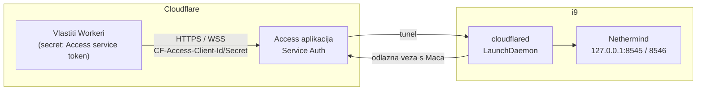

# 2026-10-11 — Plan: port forwarding i Cloudflare Tunnel

> **Ažurirano 2026-10-22:** korak 1 (port forwarding) je napravljen, ali s portovima 30313/9010 umjesto 30303/9000 i kroz dva routera. Stanje, mjerenja i screenshotovi su u [docs/10 — Mreža i port forwarding](10-network.md). Cloudflare Tunnel (korak 2) još nije započet.
>
> Izvorni status: **plan, ništa od ovoga nije napravljeno.** Čvor prvo neko vrijeme radi 24/7 bez promjena (Wi-Fi, bez port forwarda, bez tunela), da se vidi kako se ponaša. Tek nakon toga slijede koraci ispod.

Polazno stanje je opisano u [dnevniku prve instalacije](2026-10-10-prvo-pokretanje-i9-disk.md). Čvor je sinkroniziran od 2026-10-11 00:27. U mirovanju Nethermind troši ~16 % CPU-a, a sustav je 95 % idle. Ima 11–12 EL i ~25 CL peerova, ~227 GiB slobodnog diska i bazu od ~300 GB.

Port forwarding i tunel su dvije neovisne stvari:

| | Port forwarding | Cloudflare Tunnel |
| --- | --- | --- |
| Čemu služi | P2P: više peerova, čvor služi podatke mreži | **RPC**: vlastite aplikacije pitaju čvor |
| Smjer prometa | dolazno, pravilo na routeru | odlazno s Maca, na routeru se ne otvara ništa |
| Odluka | [ADR-009](02-decisions.md#adr-009) | [ADR-005](02-decisions.md#adr-005), [docs/06](06-rpc-exposure.md) |
| Ovisi o drugome | ne | ne |

## 0. Razdoblje promatranja (sada)

Što pratiti dok čvor radi bez promjena, i što upisati u [Dnevnik](05-operations.md#dnevnik):

- `scripts/gnosisctl health` povremeno: head star manje od 30 s, Teku `sync distance 0`, broj peerova;
- **rast stanja**: `du -sh /opt/gnosis/data/nethermind/nethermind_db/gnosis/state` (146 GB na 2026-10-11), tjedno. Iz toga se odlučuje o full pruningu i procjeni trajanja diska;
- slobodan disk: `df -h /System/Volumes/Data` (pomični prozor od 367 dana bi trebao držati povijest stalnom);
- CPU Netherminda (`ps -o %cpu= -p $(pgrep -x nethermind)`): treba ostati oko 16 %. Ako opet naraste na stotine posto, uzrok se traži s `gnosisctl dotnet-trace 30` ([poznati problemi](05-operations.md#poznati-problemi));
- prekidi Wi-Fi veze i njihov učinak na peerove;
- ventilatori u mirovanju (TG Pro).

Pravi restart bez logina ([runbook § 8](04-install-runbook.md#8-pravi-restart)) je dio istog razdoblja, jer pokazuje hoće li se čvor sam vratiti.

## 1. Port forwarding (P2P)

**Cilj.** Više EL peerova (sada 11–12 od 50) i stabilnija veza. Usput se testira da filtar nedavnih IP-ova i dalje može ostati isključen (`--Network.FilterPeersByRecentIp false`).

**Na routeru.** Statična javna IPv4 adresa ureda, pravila prema LAN adresi i9. Vanjski port je isti kao unutarnji, jer čvor objavljuje port na kojem sluša:

| Port | Protokol | Klijent | Config |
| --- | --- | --- | --- |
| 30303 | TCP + UDP | Nethermind (devp2p + discovery) | `EL_P2P_PORT` |
| 9000 | TCP + UDP | Teku (libp2p + discv5) | `CL_P2P_PORT` |
| 9001 | UDP | Teku (QUIC) | `CL_QUIC_PORT` |

LAN adresa i9 mora biti stalna: DHCP rezervacija na routeru.

**Na Macu.**

1. Firewall već pušta `nethermind` i `java` (`/usr/libexec/ApplicationFirewall/socketfilterfw --listapps`, „Allow incoming connections”). Provjeriti ponovno, jer se nakon upgradea binarija putanja mijenja.
2. Teku plist dobiva `--p2p-quic-port` tek s `sudo scripts/30-services.sh install teku`. Vrijednost je ista kao Tekuov default, pa ovo nije preduvjet.

**Mjerenje prije i poslije** (svaki put 24 h, upisati u dnevnik):

- EL i CL peerovi (`gnosisctl health`, `Peers:` u Nethermind logu);
- upload i download (`nettop -P -L 1 -J bytes_in,bytes_out` za `nethermind` i `java`);
- CPU Netherminda i Tekua;
- dolaze li stvarno dolazne veze: za Teku `curl -s 127.0.0.1:5052/eth/v1/node/peers | grep -o '"direction":"inbound"' | wc -l`. Za Nethermind je dovoljno da broj EL peerova poraste iznad dosadašnjih 11–12. Kako Nethermind 2.1.0 u logu prikazuje dolazne veze, nije provjereno.

**Rizici.** Otvoreni su samo P2P portovi. RPC (8545/8546), Engine API (8551) i REST (5052) ostaju na `127.0.0.1` ([docs/09](09-security.md)).

## 2. Cloudflare Tunnel za RPC (faza 1: vlastiti Workeri)

**Cilj.** Vlastiti Cloudflare Workeri, na kojima su aplikacije, pitaju RPC ovog čvora umjesto javnog RPC-a ili Infure.

**Razlika od [docs/06](06-rpc-exposure.md).** docs/06 je pisan za mobilni novčanik. Tamo javni proxy Worker filtrira metode i ograničava zahtjeve, jer se tajna ne smije ugraditi u aplikaciju. Kad RPC zovu **vlastiti Workeri**, oni Access service token mogu držati kao secret. Javni proxy tada nije potreban. Ovo je prijedlog za **ADR-011**, a ADR se piše kad se odluči.

**Koraci** (detalji naredbi su u [docs/06 § Postavljanje na Macu](06-rpc-exposure.md#postavljanje-na-macu)):

1. Provjeriti zadnju verziju `cloudflared` (GitHub releases API) i ažurirati `CLOUDFLARED_VERSION` i checksum u `config/versions.env` (sada 2026.9.3).
2. `sudo scripts/20-install.sh cloudflared`.
3. `cloudflared tunnel login` (bira se zona), pa `cloudflared tunnel create gnosis-node`. Credentials JSON ide u `/etc/cloudflared/`, nikad u git.
4. `/etc/cloudflared/config.yml`: jedan hostname prema `http://127.0.0.1:8545`, drugi za WebSocket prema `http://127.0.0.1:8546`, i na kraju `http_status:404`.
5. `cloudflared tunnel route dns …` za oba hostnamea.
6. `sudo cloudflared service install`: LaunchDaemon. Bez sudo nastaje LaunchAgent, koji ne radi bez logina. Zatim provjeriti BTM (`sudo sfltool dumpbtm | grep -A8 cloudflare`).
7. Zero Trust → Access → Applications: self-hosted aplikacija za oba hostnamea, politika **Service Auth**, pa novi service token.
8. U svakom Workeru koji zove RPC: secreti `CF_ACCESS_CLIENT_ID` i `CF_ACCESS_CLIENT_SECRET`, koji se šalju kao `CF-Access-Client-Id` i `CF-Access-Client-Secret`.
9. Test: zahtjev bez tokena mora dobiti 403 od Accessa, a `eth_blockNumber` s tokenom mora vratiti vrh lanca.

**Zaštita čak i ako token procuri.** Nethermind izlaže samo `[Eth,Net,Web3,Subscribe,Health]`, a `admin_*`, `debug_*` i `engine_*` ne postoje na 8545. Engine API (8551) nikad ne ide u tunel.

**Otvorene odluke prije početka:**

- koja Cloudflare zona (domena) i koji hostnameovi, npr. `gnosis-rpc.<zona>` i `gnosis-ws.<zona>`;
- jedan service token za sve Workere ili po jedan za svaki (lakše opozivanje);
- treba li logiranje ili rate limit već u fazi 1.

**Alternativa za provjeriti: Workers VPC.** Cloudflare ima noviji način da Worker preko bindinga dođe do servisa iza tunela, bez javnog hostnamea. To bi bilo zatvorenije od Access hostnamea. Status (beta ili GA), ograničenja i podrška za WebSocket **nisu provjereni**. Provjeriti u Cloudflare dokumentaciji prije odluke (CLAUDE.md, pravilo 1).

## 3. Faza 2: javni RPC za novčanik (kasnije)

Kad Domovina novčanik bude trebao RPC izravno s mobitela, vrijedi dizajn iz [docs/06](06-rpc-exposure.md): javni proxy Worker s listom dopuštenih metoda, ograničenjem broja zahtjeva i service tokenom prema originu. Faza 1 se ne mijenja, nego proxy Worker postaje još jedan klijent tunela.

## Vezani dokumenti

- [docs/10 — Mreža i port forwarding](10-network.md): provedeni korak 1
- [docs/06 — RPC prema van](06-rpc-exposure.md): naredbe za cloudflared i dizajn javnog proxyja
- [ADR-005](02-decisions.md#adr-005) (zero ingress za RPC), [ADR-009](02-decisions.md#adr-009) (P2P ingress)
- [Dnevnik prve instalacije](2026-10-10-prvo-pokretanje-i9-disk.md)
- [docs/09 — sigurnost](09-security.md)
