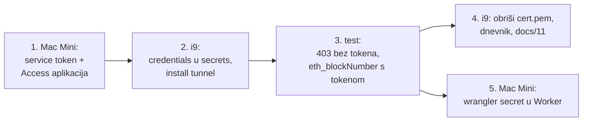

# Predaja: dovršetak RPC tunela `acutis` (2026-10-22)

> Upute za nastavak na drugom računalu (Mac Mini s `wrangler`) i završne korake na i9.
> Odluke: [ADR-011](02-decisions.md#adr-011) (tunel), [ADR-012](02-decisions.md#adr-012) (ime). Postupak općenito: [docs/06](06-rpc-exposure.md).

## Stanje u trenutku predaje

| Što | Stanje |
| --- | --- |
| `cloudflared` 2026.10.3 na i9 | instaliran, `/opt/gnosis/cloudflared/current` |
| Tunel `acutis` | stvoren, UUID `f751f6fe-8a00-4895-a2d4-79e175a90b6d` |
| DNS | CNAME `acutis-rpc.mpt.hr` i `acutis-ws.mpt.hr` → tunel |
| `config/node.env` na i9 (lokalno, nije u gitu) | `TUNNEL_ENABLED=true`, `NODE_NAME=acutis`, `TUNNEL_ZONE=mpt.hr`, `TUNNEL_ID=f751f6fe-…` |
| Credentials JSON | još u `~ms/.cloudflared/f751f6fe-8a00-4895-a2d4-79e175a90b6d.json` na i9 |
| `cert.pem` (kontrola nad cijelom zonom) | još u `~ms/.cloudflared/cert.pem` na i9 |
| Servis `tv.domovina.gnosis.tunnel` | **nije pokrenut** |
| Cloudflare Access | postavljen 2026-10-22: token `eure-reader`, aplikacija `acutis-rpc` (403 bez tokena) |

**Redoslijed je obavezan: prvo Access (korak 1), tek onda servis na i9 (korak 2).** Čim servis radi, hostnameovi su dostupni s interneta; bez Accessa bi RPC bio otvoren svima.



## 1. Mac Mini: Cloudflare Access

`wrangler` ne stvara Access aplikacije ni service tokene; to ide kroz dashboard (ili Cloudflare API s tokenom koji ima Access prava, ako se tako odluči; endpointove tada provjeriti u dokumentaciji, CLAUDE.md pravilo 1).

1. `git pull` u ovom repou.
2. [one.dash.cloudflare.com](https://one.dash.cloudflare.com/) → **Access → Service Auth → Service Tokens → Create Service Token**
   - Name: `eure-reader` (jedan token po Workeru, [ADR-011](02-decisions.md#adr-011)).
   - Duration: po izboru (Non-expiring ili 1 godina uz rotaciju).
   - **Client ID i Client Secret odmah spremiti u password manager.** Secret se prikazuje samo jednom. Nikad u git.
3. **Access → Applications → Add an application → Self-hosted**
   - Application name: `acutis-rpc`.
   - Public hostnames: `acutis-rpc.mpt.hr` i `acutis-ws.mpt.hr`.
   - Policy: name `workers`, **Action: Service Auth**, Include → **Service Token** → `eure-reader`.
   - Nikakva Allow politika za ljude (e-mail, IdP).
4. Provjera prije koraka 2: u popisu aplikacija `acutis-rpc` ima oba hostnamea i jednu politiku s akcijom Service Auth.

## Izvedba koraka 1 (2026-10-22, Mac Mini)

Access je postavljen kroz dashboard, račun **D.O.M.** (`7dc7167b7e2e00923bfa7cd697df14e4`; zona `mpt.hr` je tamo, provjereno preko API-ja `zones?name=mpt.hr`).

- Dashboard je preimenovao izbornik: service tokeni su sada **Zero Trust → Access controls → Service credentials** (`/one/access-controls/service-credentials`), aplikacije **Access controls → Applications** (`/one/access-controls/apps`). Stari put `/access/service-auth` vraća 404.
- `wrangler` OAuth token nema Access prava (scopeovi bez `access`), pa API put nije bio moguć bez novog API tokena.
- Aplikacija: tip *Self-hosted and private → Public DNS*, dva public hostnamea, politika `workers` (Action **Service Auth**, Include **Service Token** = `eure-reader`; ne „Any Access Service Token”, jer bi tada prošao i token drugog Workera, npr. `domovina-analytics-worker`).
- Client ID i Secret su na Mac Miniju u `secrets/cf-access-eure-reader.env` (gitignored, 600) i u password manageru. Secret se prikazuje samo jednom: dok je ekran s njim otvoren, ne navigirati taj tab (prvi secret je tako izgubljen i token je morao dobiti novi).

Provjera izvana, prije pokretanja tunela:

| Zahtjev | `acutis-rpc` | `acutis-ws` | Značenje |
| --- | --- | --- | --- |
| bez tokena | 403 | 403 | Access blokira |
| s tokenom | 530, error 1033 | 530, error 1033 | Access propušta; tunel još nema aktivnih veza |

Nakon koraka 2 isti zahtjev s tokenom mora vratiti `"result":"0x64"`. Ako ostane 1033, tunel nije spojen (`tunnel.stderr.log` na i9).

## Izvedba koraka 2 i 4 (2026-10-22, i9)

- 22:28: sudo naredba iz § 2 je prošla, servis `tunnel` radi (`gnosisctl status`). Credentials JSON je sad u `/opt/gnosis/secrets/cloudflared/` (`_gnosis`, 600), a `~ms/.cloudflared` je prazan.
- `tunnel.stderr.log`: 4 × „Registered tunnel connection” (vie05, lju01, vie06, lju01), QUIC, svi connectivity pre-checkovi PASS.
- `ingress validate` je OK. `ingress rule`: `acutis-rpc` → `127.0.0.1:8545`, `acutis-ws` → `127.0.0.1:8546`, nepoznati hostname → pravilo #2 (`http_status:404`).
- Izvana, bez tokena: oba hostnamea **403**.
- Lokalno: `admin_peers` vraća grešku (namespace `Admin` isključen, `EnabledModules` = Eth, Net, Web3, Subscribe, Health).
- Korak 4: stari tunel `macbook-i9-64GB` (`b75d5d8e-…`) je obrisan (`tunnel delete`), zatim `cert.pem`. Na računu su ostali `acutis` i `domovina-001-coolify-oracle`.
- Testovi s tokenom (§ 3) odrađeni na Mac Miniju, vidi sljedeće poglavlje.

## Izvedba koraka 3 (2026-10-22, Mac Mini)

| Test | Rezultat |
| --- | --- |
| `eth_chainId` s tokenom | `0x64`, HTTP 200 |
| `eth_blockNumber` | isti broj kao `gnosis-rpc.publicnode.com` u istom trenutku; `eth_syncing` = false |
| `admin_peers`, `debug_traceBlockByNumber`, `personal_listAccounts`, `txpool_content` | greška -32600 („namespace … is disabled”), bez podataka |
| bez tokena / krivi secret | 403 / 403 |
| WS `eth_subscribe newHeads` s tokenom | pretplata OK, novi blok svakih ~5 s |
| WS bez tokena | handshake odbijen |

WebSocket se iz Node 24 može testirati bez `wscat`: ugrađeni `WebSocket` prima `{headers: {...}}` kao drugi argument (undici).

**Otvoreno:** korak 5 (Worker u svom repou, `wrangler secret put`).

## 2. i9: pokretanje servisa (sudo, iTerm, jedan red)

```bash
cd ~/git/domovinatv/domovina-gnosis-node && git pull && sudo mkdir -p /opt/gnosis/secrets/cloudflared && sudo mv ~/.cloudflared/f751f6fe-8a00-4895-a2d4-79e175a90b6d.json /opt/gnosis/secrets/cloudflared/ && sudo chown -R _gnosis:_gnosis /opt/gnosis/secrets/cloudflared && sudo chmod 700 /opt/gnosis/secrets/cloudflared && sudo chmod 600 /opt/gnosis/secrets/cloudflared/f751f6fe-8a00-4895-a2d4-79e175a90b6d.json && sudo scripts/30-services.sh install tunnel 2>&1 | tee /tmp/tunnel-install.log
```

Zatim (bez sudo):

```bash
scripts/gnosisctl status                       # tunnel: running
tail -50 /opt/gnosis/logs/tunnel.stderr.log    # 4 × "Registered tunnel connection"
/opt/gnosis/cloudflared/current/cloudflared tunnel --config /opt/gnosis/etc/cloudflared/config.yml ingress validate
```

Ako macOS pokaže „Allow in the Background”, dopustiti ([docs/04](04-install-runbook.md)). Ako servis ne starta: `/opt/gnosis/logs/tunnel.stderr.log` i `sudo launchctl print system/tv.domovina.gnosis.tunnel`.

## 3. Test (s bilo kojeg računala)

```bash
# bez tokena: mora biti 403 (ili 302 na Access login), nikad JSON-RPC odgovor
curl -s -o /dev/null -w '%{http_code}\n' -X POST https://acutis-rpc.mpt.hr \
  -H 'content-type: application/json' --data '{"jsonrpc":"2.0","id":1,"method":"eth_blockNumber","params":[]}'

# s tokenom: vrh lanca (hex), usporediti s gnosisctl health na i9
curl -s https://acutis-rpc.mpt.hr \
  -H "CF-Access-Client-Id: $CF_ACCESS_CLIENT_ID" -H "CF-Access-Client-Secret: $CF_ACCESS_CLIENT_SECRET" \
  -H 'content-type: application/json' --data '{"jsonrpc":"2.0","id":1,"method":"eth_chainId","params":[]}'
# očekivano: "result":"0x64" (Gnosis, chain id 100)

# zabranjeni modul: mora vratiti grešku "method not found", ne podatke
curl -s https://acutis-rpc.mpt.hr \
  -H "CF-Access-Client-Id: $CF_ACCESS_CLIENT_ID" -H "CF-Access-Client-Secret: $CF_ACCESS_CLIENT_SECRET" \
  -H 'content-type: application/json' --data '{"jsonrpc":"2.0","id":1,"method":"admin_peers","params":[]}'

# nepoznat hostname na tunelu: 404 (ingress catch-all) — provjerava se lokalno na i9:
/opt/gnosis/cloudflared/current/cloudflared tunnel --config /opt/gnosis/etc/cloudflared/config.yml ingress rule https://nesto.mpt.hr
```

WebSocket (`acutis-ws.mpt.hr`): npr. `npx wscat -c wss://acutis-ws.mpt.hr -H "CF-Access-Client-Id: …" -H "CF-Access-Client-Secret: …"`, pa poslati `{"jsonrpc":"2.0","id":1,"method":"eth_subscribe","params":["newHeads"]}`. Svakih ~5 s mora stići novi blok.

## 4. i9: zatvaranje

1. `rm ~/.cloudflared/cert.pem`: vrijedi za cijelu zonu `mpt.hr`, a treba samo za `tunnel create` i `route dns`. Za novi hostname kasnije se ponovi `tunnel login`.
2. `docs/05-operations.md` § Dnevnik: redak s rezultatima testa (HTTP kodovi, chain id, broj veza tunela).
3. `docs/06-rpc-exposure.md`: status „faza 1 radi”.
4. Odlučiti o starom neaktivnom tunelu `macbook-i9-64GB` (2026-06-30, bez veza): obrisati (`cloudflared tunnel delete macbook-i9-64GB`, treba `cert.pem`, pa prije koraka 1) ili ostaviti. Provjeriti da na njega ne pokazuje nijedan DNS zapis.
5. Opcionalno: maknuti Homebrew `cloudflared` 2026.6.1 (`brew uninstall cloudflared`), da se ne miješa s `/opt/gnosis/cloudflared`.

## 5. Mac Mini: Worker koji čita RPC

> **Izvedeno 2026-10-23:** `pay.domovina.ai` PR [#143](https://github.com/domovinatv/pay.domovina.ai/pull/143), secreti postavljeni. Popis uplata preko `eth_getLogs` čeka log index ([predaja](2026-10-23-predaja-log-index-i9.md)).

U repou Workera (ne u ovom):

```bash
wrangler secret put CF_ACCESS_CLIENT_ID
wrangler secret put CF_ACCESS_CLIENT_SECRET
```

```js
async function rpc(env, method, params = []) {
  const res = await fetch("https://acutis-rpc.mpt.hr", {
    method: "POST",
    headers: {
      "content-type": "application/json",
      "CF-Access-Client-Id": env.CF_ACCESS_CLIENT_ID,
      "CF-Access-Client-Secret": env.CF_ACCESS_CLIENT_SECRET,
    },
    body: JSON.stringify({ jsonrpc: "2.0", id: 1, method, params }),
  });
  const body = await res.json();
  if (body.error) throw new Error(`${method}: ${body.error.message}`);
  return body.result;
}
```

Za EURe transfere: `eth_getLogs` s adresom EURe ugovora i `topics[0]` = `Transfer(address,address,uint256)` (`0xddf252ad1be2c89b69c2b068fc378daa952ba7f163c4a11628f55a4df523b3ef`). Adresu EURe ugovora na Gnosisu provjeriti kod Moneriuma ili na Gnosisscanu (postoje stara i nova verzija ugovora). Ograničenja:

- povijest postoji samo za zadnjih 367 dana ([ADR-010](02-decisions.md#adr-010));
- raspon blokova po upitu držati malim (npr. ≤ 10.000) i paginirati.

## Vezani dokumenti

- [docs/06 — RPC prema van](06-rpc-exposure.md)
- [docs/11 — Imena čvorova i katalog](11-imena-cvorova.md)
- [docs/05 § Dnevnik](05-operations.md#dnevnik)
