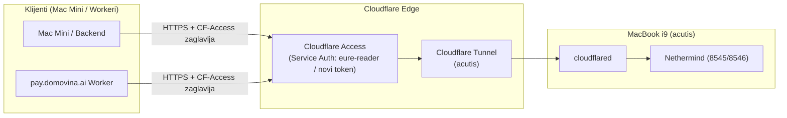

# Analiza stabilnosti čvora i vanjskog RPC pristupa (2026-10-28)

Ovaj dokument bilježi operativnu analizu rada Gnosis čvora `acutis` (MacBook Pro i9) u razdoblju od 25. do 28. listopada 2026., raščlambu mrežnog incidenta od 26. listopada, te analizu i smjernice za vanjski RPC pristup (`acutis-rpc.mpt.hr` vs. `domovina.ai`) uoči integracije na Mac Mini.

---

## 1. Višednevni operativni status (25.–28. 10. 2026.)

Čvor radi neprekidno, potpuno sinkroniziran i bez ijednog restarta još od pokretanja 25. listopada u 09:50.

| Komponenta | PID | Status (28. 10. 17:49) | Metrika |
|---|---|---|---|
| **Nethermind (EL)** | 321 | In Sync | Blok **#48989430** (0–2s star), **49 peera**, obrada blokova ~4–8 ms |
| **Teku (CL)** | 320 | In Sync | Sync distance **0**, **80 peera** (maksimum), slotovi svakih 5s |
| **Cloudflare Tunnel** | 1211 | Online | **4 QUIC veze** (vie05, vie06, lju01), `readyConnections: 4` |
| **Host** | — | Uptime > 80 sati | **215 GB** slobodnog diska, clock offset **+0.027s**, AC napajanje |

- **Obrađeni blokovi:** Kroz ~80 sati procesirano je preko **50.000 novih blokova** u realnom vremenu.
- **Rast diska:** Slobodni prostor pao je s 220 GB na 215 GB (~1.5 GB/dan), što je očekivani i zdravi tempo rasta baze stanja.
- **Logovi:** U zadnjih 48 sati nema niti jedne kritične greške (`ERROR`/`FATAL`) na EL i CL servisima.

---

## 2. Analiza događaja od 26. 10. (privremeni pad Teku peerova)

### Kronologija incidenta
Dana 26. listopada u dva navrata (u **15:37** i **16:05**) zabilježeno je privremeno opadanje peerova na Tekuu (pad s 80 na 0 peerova uz poruku `No connected peers...`).

### Utvrđeni uzrok
Problem **nije bio u klijentima (Teku/Nethermind)**, već je u ta dva navrata došlo do **potpunog prekida odlaznog internetskog prometa na cijelom Macu**:
1. **Cloudflare Tunnel (`tunnel.stderr.log`):** Točno u 15:36:55 i 16:05:41 prijavio je `timeout: no recent network activity` na sve 4 QUIC veze prema vanjskim centrima (Beč, Ljubljana) i privremeni prekid veza (`failed to dial to edge with quic`).
2. **Nethermind (`gnosis.9.log`):** Točno u 15:37:03 zabilježio je `49 of 49 checked nodes did not respond to a Ping message - 100%`, a ubrzo potom su i EL peerovi pali na 0.
3. **Teku (`teku.log`):** U roku od 30 sekundi izgubio je TCP veze s peerovima (80 → 47 → 32 → 5 → 0).
4. **Sustav:** Pregledom `pmset -g log` potvrđeno je da Mac nije išao u sleep. Uzrok je bio prolazni lokalni prekid Wi-Fi veze (`en0`) ili kućnog routera/ISP-a (prvi prekid trajao ~90 s, drugi ~3–4 min).

### Ponašanje i oporavak
Čim se internetska veza vratila:
- Cloudflare tunel se automatski re-konektirao unutar 1–2 sekunde.
- Teku je samostalno pronašao peerove i vratio se na punih 80 peera.
- Nethermind je unutar nekoliko stotina milisekundi povukao i procesirao sve propuštene blokove.
- Nije bila potrebna nikakva ručna intervencija niti restart servisa.

### Utjecaj na staking i validatore (Slashing vs. Offline penali)
Postavljeno je pitanje bi li takav prekid prouzročio **slashing** za stejkani GNO:
- **Slashing (rezanje pologa): NE.** Slashing je protokolarna kazna isključivo za zlonamjerne/dvostruke radnje (*double signing* ili *surround vote* kada se isti ključevi pokrenu na dva mjesta). Čvor koji nema internet ne potpisuje ništa i kriptografski ne može biti slashan.
- **Offline penali (inactivity penalties): Zanemarivi.** Kad validator nema vezu, propušta atestacije. Primjenjuje se pravilo simetrije: gubi se onoliko koliko bi se zaradilo u tom vremenu. Za prekid od 2–3 minute propušta se par atestacija (gubitak manji od centa), što se nadoknadi unutar desetak minuta redovnog rada nakon povratka veze.
- **Preporuka za budući validator:** Za maksimalnu pouzdanost i uklanjanje Wi-Fi mikro-prekida, spojiti čvor putem Ethernet kabela.

---

## 3. Analiza vanjskog RPC pristupa (`acutis-rpc` / `domovina.ai`)

### Zašto `acutis-rpc.domovina.ai` trenutno ne vraća ništa?
1. **Domena:** Prema arhitekturi ([ADR-011](02-decisions.md#adr-011)), tunel za ovaj čvor postavljen je u zoni **`mpt.hr`**, a ne `domovina.ai`:
   - HTTP RPC: `https://acutis-rpc.mpt.hr`
   - WebSocket: `wss://acutis-ws.mpt.hr`
   - Hostname `acutis-rpc.domovina.ai` ne postoji u DNS-u (`Could not resolve host`).
2. **Lokalni ingress:** Lokalni `cloudflared` u `/opt/gnosis/etc/cloudflared/config.yml` usmjerava samo `acutis-rpc.mpt.hr` i `acutis-ws.mpt.hr` na Nethermind (8545/8546), dok za sve ostale hostnameove vraća HTTP 404.

### Zašto `acutis-rpc.mpt.hr` vraća HTTP 403 Forbidden?
Čvor je namjerno i u skladu s arhitekturom zaštićen iza **Cloudflare Zero Trust Access** aplikacije:
- Pristup je dozvoljen isključivo uz **Service Token** (Service Auth politika).
- Svaki zahtjev izvana mora sadržavati zaglavlja:
  - `CF-Access-Client-Id`
  - `CF-Access-Client-Secret`
- Bez tih zaglavlja Cloudflare odmah odbija zahtjev s kodom 403, čime se štiti čvor od skeniranja, botova i preopterećenja s javnog interneta.

---

## 4. Smjernice za spajanje s Mac Minija / vanjskih klijenata

Kako je dogovoreno, na i9 čvoru se ništa ne mijenja jer radi stabilno. Sve konfiguracije spajanja odrađivat će se s klijentske strane (Mac Mini):



### Koraci za spajanje s Mac Minija (Faza 1):
1. **Service Token:**
   - U Cloudflare Zero Trust dashboardu (*Access → Service Auth → Service Tokens*) iskoristiti postojeći token (npr. `eure-reader` koji već koristi `pay.domovina.ai`) ili stvoriti novi namjenski token za Mac Mini.
   - Osigurati da je token uključen u politiku aplikacije `acutis-rpc`.
2. **Poziv iz skripte / aplikacije:**
   ```bash
   curl -s -X POST https://acutis-rpc.mpt.hr \
     -H "CF-Access-Client-Id: $CF_ACCESS_CLIENT_ID" \
     -H "CF-Access-Client-Secret: $CF_ACCESS_CLIENT_SECRET" \
     -H "Content-Type: application/json" \
     --data '{"jsonrpc":"2.0","method":"eth_blockNumber","params":[],"id":1}'
   ```
3. **Ako se želi podrška za domenu `domovina.ai`:**
   - U Cloudflareu dodati CNAME `acutis-rpc.domovina.ai` na UUID tunela.
   - U Cloudflare Accessu dodati hostname `acutis-rpc.domovina.ai` u aplikaciju.
   - Na i9 u `config/node.env` i `/opt/gnosis/etc/cloudflared/config.yml` dodati ingress pravilo za taj hostname (kad se za tim ukaže potreba).
