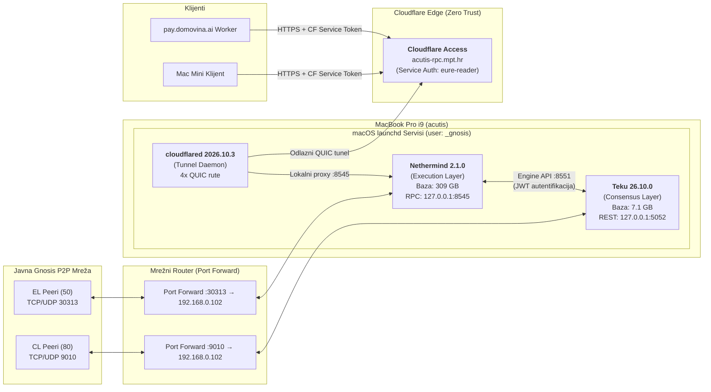
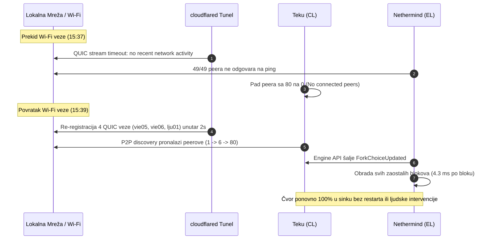

# Izvještaj o stabilnosti i radu Gnosis čvora (10. — 30. listopada 2026.)

> **Status:** Čvor `acutis` (MacBook Pro 16" Intel i9 / 64 GB RAM / macOS 26.6.2) radi **neprekidno, potpuno sinkronizirano i stabilno**.  
> Od zadnjeg planiranog restarta sustava (25. 10. u 09:50) servisi bilježe **preko 125 sati neprekidnog rada (5+ dana uptime)** pod istim PID-ovima, s preko **88.000 uspješno procesiranih blokova** u realnom vremenu i nula kritičnih incidenata.

---

## 1. Sažetak rada (Executive Summary)

Gnosis čvor na namjenskom MacBook Pro računalu pokrenut je 10. listopada 2026. Nakon početne sinkronizacije i optimizacije procesorskih niti, čvor je postavljen pod nadzor macOS `launchd` servisa. Sustav kontinuirano opslužuje Execution Layer (Nethermind), Consensus Layer (Teku) i Cloudflare tunel za siguran vanjski RPC pristup.

| Parametar | Činjenično stanje (30. 10. 2026. 14:37) |
|---|---|
| **Uptime stroja (OS)** | **5 dana, 4 sata, 47 minuta** (neprekidno od 25. 10. 09:50) |
| **Uptime servisa (PID)** | **Nethermind (PID 321): 125h** \| **Teku (PID 320): 125h** \| **Tunnel (PID 1211): 125h** |
| **Trenutni blok** | **#49021142** (kašnjenje **0s**, u vrhu lanca) |
| **Obrađeno blokova od restarta** | **> 88.400 blokova** (Gnosis ritam: 1 blok svakih 5 sekundi) |
| **P2P Peerovi** | **EL:** 50 peera (od 50 max) \| **CL:** 80 peera (od 80 max, 58 dolaznih) |
| **Pohrana (/opt/gnosis/data)** | **316 GB ukupno** (Nethermind 309 GB, Teku 7.1 GB) |
| **Slobodan prostor na disku** | **212 GB slobodno** (stabilna potrošnja ~1.5 GB/dan) |
| **Vanjski RPC tunel** | **4 aktivne QUIC veze** prema Cloudflare rubnoj mreži |

---

## 2. Kronologija razvoja i rada (10. — 30. listopada 2026.)

```mermaid
flowchart TD
    F1["<b>10. 10. — Inicijalno pokretanje</b><br/>• Postavljen /opt/gnosis, preflight i skripte<br/>• Snap sync stanja gotov za 4 h 13 min<br/>• Povijest (receipts/bodies) gotova za 6 h 15 min"]
    
    F2["<b>11. 10. — Optimizacija resursa</b><br/>• Riješen .NET semaphore spin limit (CPU s 1500% na 530%)<br/>• Riješena PeerManager petlja (--FilterPeersByRecentIp false)<br/>• Postavljen prozor povijesti na 367 dana (RetentionEpochs)"]
    
    F3["<b>11. — 22. 10. — Faza stabilizacije</b><br/>• 11 dana stabilnog rada bez rušenja<br/>• Prosječan CPU: Nethermind ~46%, Teku ~22% jedne jezgre<br/>• Rotacija NLog i Teku logova funkcionira bez zastoja"]
    
    F4["<b>22. 10. — Launchd i Cloudflare Tunel</b><br/>• Uspostavljeni launchd daemoni tv.domovina.gnosis.*<br/>• Izrađen gnosisctl operativni alat<br/>• Uspostavljen Cloudflare tunel acutis (acutis-rpc.mpt.hr)"]
    
    F5["<b>23. 10. — Uključivanje Log Indexa</b><br/>• Uključen NM_LOG_INDEX=true (ADR-013)<br/>• Backfill 6,35M blokova odrađen za samo 55 min<br/>• eth_getLogs ubrzan sa 145 s na 0,1 s"]
    
    F6["<b>25. 10. — Testiranje restarta i mrežne konfiguracije</b><br/>• Provjera automatskog starta nakon restarta sustava<br/>• Otkriven i otklonjen macOS rotating Wi-Fi MAC problem<br/>• Fiksiran IP 192.168.0.102 uz rad port forwarda (dolazni peerovi)"]
    
    F7["<b>25. — 30. 10. — Kontinuirani rad (>125h neprekidno)</b><br/>• 0 restarta, isti PID-ovi kroz 5 dana<br/>• Samostalno preživljen i oporavljen kraći Wi-Fi prekid (26. 10.)<br/>• Potpuni sink, nula kritičnih grešaka, spremno za Mac Mini"]

    F1 --> F2 --> F3 --> F4 --> F5 --> F6 --> F7
```

---

## 3. Arhitektura sustava

Čvor je izveden u slojevitoj arhitekturi: sav dolazni P2P promet ide kroz port forwarding s routera, dok se sav RPC promet prema van odvija isključivo preko odlaznog tunela s nultim povjerenjem (Zero Trust).

---

## 4. Činjenične metrike rada i performansi

### A. Potrošnja resursa (Mjerenje 30. 10. 2026.)
| Komponenta | CPU (prosjek) | Memorija (RSS) | Baza na disku | Zadnji exit code |
|---|---|---|---|---|
| **Nethermind** | ~32 % jedne jezgre | 6.36 GB | 309 GB (s logIndexom) | Nikad nije izašao (0) |
| **Teku** | ~41 % jedne jezgre | 11.03 GB | 7.1 GB | Nikad nije izašao (0) |
| **cloudflared** | < 0.1 % | 38 MB | — | 1 (samo pri bootu prije mreže) |
| **Ukupno računalo** | ~75 % idle | ~28 GB zauzeto (od 64 GB) | 316 GB (od 500 GB kvote) | Uptime 5d 4h 47m |

### B. Stabilnost diska i automatski pruning
- **Početno stanje (11. 10.):** 227 GB slobodno (baza ~304 GB).
- **Nakon log indexa (23. 10.):** 211 GB slobodno (baza `logIndex` zauzela 3.2 GB).
- **Trenutno stanje (30. 10.):** 212 GB slobodno.
- **Zaključak:** Zahvaljujući konfiguriranom pomičnom prozoru povijesti od 367 dana (`RetentionEpochs = 198180` po 32 bloka), Nethermindov ugrađeni pruner automatski briše prestare block bodies i receipts. Rast baze je stabiliziran na svega **~1 do 1.5 GB dnevno**.

---

## 5. Otpornost na mrežne smetnje i dokaz stabilnosti

### A. Automatski oporavak nakon Wi-Fi prekida (Incident 26. 10.)
Dana 26. listopada u dva navrata (15:37 i 16:05) došlo je do kratkotrajnog prekida lokalne Wi-Fi veze na čvoru (prekidi su trajali 90 sekundi i ~3 minute).

### B. Zašto privremeni prekidi ne ugrožavaju validator (Slashing analiza)
- **Slashing rizik:** **0 %**. Protokol kažnjava slashingom isključivo kriptografski dokazano dvostruko potpisivanje (*double signing*) ili proturječne atestacije (*surround vote*). Čvor bez interneta ne emitira ništa i ne može biti slashan.
- **Inactivity penali:** Prekid od 2–3 minute rezultirao bi propuštanjem tek nekoliko atestacija (gubitak manji od 0.001 GNO), što se nadoknađuje unutar 10 minuta redovnog rada po povratku na mrežu (pravilo simetrije).

---

## 6. Status vanjske integracije (Cloudflare Access RPC)

Čvor poslužuje RPC upite kroz šifrirani tunel prema domenama čvora `acutis`:
- **HTTP RPC:** `https://acutis-rpc.mpt.hr`
- **WebSocket:** `wss://acutis-ws.mpt.hr`

Svi vanjski zahtjevi bez `CF-Access-Client-Id` i `CF-Access-Client-Secret` zaglavlja bivaju trenutno odbačeni na Cloudflare rubu s kodom **HTTP 403 Forbidden**. Ovime je origin u potpunosti zaštićen od skeniranja portova i DoS napada.

Upogonjeni **Log Index (ADR-013)** omogućuje trenutačno pretraživanje događaja pametnih ugovora (npr. Monerium EURe uplate za Safe novčanike) preko cijele godine povijesti u **0.1 do 0.2 sekunde** (prije uvođenja indeksa upit je trajao 145 sekundi).

---

## 7. Zaključak i spremnost

Gnosis čvor `acutis` pokazao je:
1. **Izvrsnu hardversku i sistemsku stabilnost** na Intel i9 MacBook Pro platformi pod macOS-om.
2. **Autonomnu robusnost** (sposobnost potpunog samoizlječenja nakon mrežnih prekida bez ljudske intervencije).
3. **Visoku propusnost i niske latencije** obrade blokova (4–8 ms po bloku).

Sustav je u potpunosti operativan i spreman za sljedeću fazu: povezivanje klijenata s Mac Minija i aktivaciju validatora.
